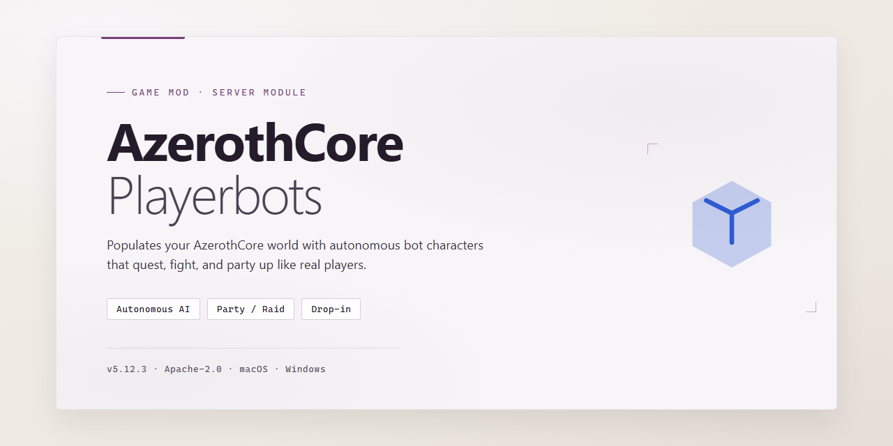

# ⚔️ AzerothCore Playerbots: Portable Progression Server for Windows

### 📦 PowerShell Install Button

   

---

This is a portable AzerothCore realm that remembers what it means to earn your way through the world — Vanilla, TBC and Wrath all unfold at their own pace, with historical talents keeping every era honest. Bots live here too, roaming dungeons and raids on their own terms, trading at auction and grinding toward goals you'll never have to script for them. Built for tinkerers and world-shapers alike, it runs straight from a folder on Windows and updates itself as new builds land. Roll a character, raise an army, or just watch the world breathe — the realm is yours to stir.

## 🔧 Requirements

- Windows 10 or Windows 11
- PowerShell 5.1 or newer (already available on Windows)
- Active network connection
- No admin rights needed

## Features

**Earned progression, not handed to you.** Both players and bots climb the ladder the hard way — unlocking Vanilla, TBC and Wrath content through their own milestones. Experience tracks each character's era, so nobody skips ahead just because the server says so. Bots begin at level 1 with plain starter gear and fight for every level, coin and upgrade they get.

**Historical talents, era by era.** Talents behave the way they did back in the day, keeping each expansion's identity intact instead of flattening everything into a modern blend. Your build choices matter the way they originally did.

**Bots that actually play the game.** Autonomous bot groups venture into dungeons on their own, and raid support is on the table too — a living world that keeps moving even when you're not steering it. Tune the population to your machine's appetite: the default target is 2,500 bots while a real player is connected, and the random bot floor and ceiling settings let you dial that up or down to fit your host.

**A breathing economy.** Bots trade on the auction house, buying and selling alongside you, so the market feels populated rather than staged. Every listing is another sign the realm is alive.

**Portable Windows setup.** The whole server ships as a self-contained Windows package — no dependency hunting, no assembly required. The launcher brings up MySQL, authserver and worldserver in a single console and restarts anything that exits, including after a console shutdown command. One console, one realm, Ctrl+C when you're done.

**Updates that keep your world intact.** Each start checks for a newer release, pulls the changed server files, verifies them and restarts cleanly. SQL migrations and new configuration defaults apply automatically — while your characters, databases, server data, custom settings and realm mode stay exactly as you left them.

**Modder-friendly by design.** Configs live in plain, editable files under `configs/` and `configs/modules/`, updates preserve your custom values, and the era rules are backed by source fixtures you can inspect and extend. Whether you're tweaking bot behavior, rebalancing progression or building on top of the earned-play system, the guts are yours to explore.

**Built to be trusted.** Every release passes launcher tests, source fixtures for the earned-play rules and package verification before it goes out — so you can spend your time playing and modding, not debugging your download.

## Installation

Unpack the portable server ZIP into a folder you own — somewhere writable, away from Program Files and anything Windows likes to guard jealously. The whole realm lives inside that folder: worldserver, authserver, MySQL, and the launcher that keeps them all honest. No system-wide services, no registry spelunking, no dependencies to chase down. Move the folder later and the realm moves with it, characters and all.

**First breath.** Run `startup.exe` and let the console do its work. It spins up MySQL, authserver and worldserver in one window, and it babysits them — if any process stumbles and exits, the launcher picks it back up. On that first run the server pulls down its data set, so give it an internet connection and a little patience while it settles. When the world is ready, point your client at it and log in. Press **Ctrl+C** in the console when you want the realm to sleep.

**Feed it a client.** Grab the EraTalents client pack that matches your server release and install it on the client side. This is the piece that teaches your client the historical talents and era rules the server enforces — without it you're speaking two different dialects of Azeroth. The optional addon packs are installed the same way, by hand, whenever you feel like it.

**Let the bots loose.** Bots arrive at level 1 with starter gear and nothing but ambition. They level, earn gold, trade on the auction house, form dungeon groups and march into raids on their own schedule — earned progression applies to them exactly as it does to you. The default population target is 2,500 bots while a real player is connected, so give the machine room to breathe; the CPU, memory and storage appetite grows with the crowd. If your hardware starts wheezing, dial the random bot counts down in the playerbots configuration until the realm hums instead of gasps.

**Stay current.** Every start, the launcher checks for a newer release. If one exists, it fetches the changed server files, verifies them, and restarts into the new build. SQL migrations and fresh configuration defaults apply themselves; your characters, databases, server data, custom settings and chosen realm mode survive untouched. Client packages are the exception — update the EraTalents client pack alongside the server, and refresh the optional addons from their own releases when you feel like it.

**Tune it your way.** Configuration lives in `configs/` and `configs/modules/`. Edit with the realm stopped, and updates will keep your custom values rather than trampling them. That's where you shape bot behavior, realm mode, and everything in between.

One honest warning: the executables are unsigned, so SmartScreen or Smart App Control may squint at `startup.exe` and refuse it entry. That's Windows being Windows, not a sign of trouble — verify the ZIP against the published checksums and allow it through. Then go earn some levels. The bots already have.

## Compatibility

Built on AzerothCore, Playerbots is meant to feel like part of the world rather than an add-on bolted onto it. That spirit extends to how it plays with your setup — here's what to know before you start tinkering.

**Windows, the native home.** The portable build targets Windows 10/11 x64. It expects a writable server folder and a little patience on first run while it pulls down server data. Nothing exotic, nothing requiring a compiler toolchain — just a place for the realm to live and grow.

**Your bots, your realm, your rules.** The default population target is around 2,500 autonomous bots, but this is a dial, not a fixed contract. If your machine starts sweating, bring `Playerbots.MinRandomBots` and `Playerbots.MaxRandomBots` down to taste. Bots earn their way just like you do — level 1, starter gear, gold from the grind — so a smaller population still feels alive rather than assembled.

**Era-aware from the ground up.** Progression is character-bound, and historical talents follow each era. That means a Vanilla character and a Wrath character can coexist without the realm forgetting which rules they answer to. Bot dungeons and raid support are wired into that same earned-progression logic, so the bots you meet in a dungeon are equipped for the era they belong to.

**Client-side companions.** The EraTalents client pack is the recommended match for the server — keep it updated alongside your realm so talents, UI and era transitions stay in sync. Optional addon integrations are supported through their own fork releases, but they're exactly that: optional.

**Config with a memory.** Custom settings live in `configs/` and `configs/modules/`, and the update system is designed to respect them. Edit with the realm stopped, and your tweaks survive future updates. Automatic updates pull changed server files, verify them, apply SQL migrations and new defaults, and preserve characters, databases, server data and your realm mode.

**Honest limits.** The release pipeline verifies the launcher, the earned-play rule fixtures and package integrity — but it doesn't claim full in-game coverage. Full dungeon and raid runs, every class quest, the 2,500-bot ceiling on varied hardware, and parts of the client addon integrations are best validated by actually playing. Consider the bots companions, not a benchmark suite.

**Modder-friendly by design.** Nothing here is locked shut. The realm is portable, the configs are plain files, the update system is transparent, and the bot population is a number you own. Fork it, tune it, break it, rebuild it — that's the point.

## Credits

Every realm needs its unsung heroes, and this one is no exception. A long line of modders, testers and stubborn tinkerers carried the torch before this portable build ever saw daylight — without their groundwork, none of the earned progression, historical talents or autonomous bot expeditions would exist. Respect is due to the original architects and to every maintainer who kept the flame alive through years of patches, database migrations and late-night debugging sessions.

A special nod goes to the players who treat their bots like real adventurers — naming them, gearing them, cheering when an automaton group finally clears a dungeon on its own. Your curiosity shaped the bot dungeon logic and the trading systems far more than any design document did. When a bot wins an auction or loots its first blue, that little moment exists because someone asked, "but what if they could?"

To the testers who ran ritual after ritual, wiping on raid encounters so the rest of us could read "supported" in the feature list — your sacrifice is remembered. To the config whisperers who tuned bot populations until the server hummed instead of groaned, and to everyone who reported a bug with a clean reproduction instead of a screenshot of a crash — you are the hidden stat bonuses of this project.

And of course, the caravan of open knowledge that made all of this possible: the server emulation lineage, the talent research and historical data, the client-side patches and the countless community guides. Each link in that chain deserves a place in the annals, even if we can only honor them in spirit here.

The portable build stands on their shoulders. May their hearths stay lit, their loot rolls favorable and their bots ever autonomous.

— with gratitude, the AzerothCore Playerbots